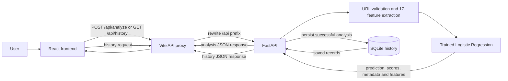

# PHISHGUARD AI

**AI-based phishing URL classification research prototype**<br>
Final-year B.Tech Information Science and Engineering project, REVA University<br>
Academic year 2025–2026

PhishGuard AI accepts an HTTP(S) URL string, extracts 17 deterministic lexical and structural URL measurements, and returns a prediction from the selected Logistic Regression model. Training and API inference use the same canonical URL representation. The local React application displays the prediction, uncalibrated model scores, model metadata, a separate novelty result, and mathematical Logistic Regression contributions alongside measured inputs. Successful URL analyses are stored in a local SQLite database; pasted email triage remains transient.

This is a research classifier, not a verified security verdict. It does not visit the submitted destination, inspect a page, look up reputation, or verify current safety.

## Problem and purpose

Phishing links can imitate legitimate services and exploit URL patterns to mislead people. This project studies whether URL-string characteristics can support binary phishing/legitimate classification using a prepared research dataset and a reproducible machine-learning pipeline. Its output is intended for academic demonstration and evaluation, not as a replacement for browser protections or human security judgment.

## What is implemented

- URL-only classification through a React 19 and TypeScript frontend.
- FastAPI inference using model version `url-classifier-3` and 17 ordered URL features.
- Prediction result, uncalibrated class scores, threshold and model metadata.
- Per-analysis Logistic Regression contributions that reconstruct the phishing logit, clearly separated from measured URL characteristics.
- A separately loaded `url-novelty-1` Isolation Forest result; missing novelty artifacts do not disable URL classification.
- Transient offline email header parsing and HTTP(S) link screening from plain text and HTML `href` values. Email messages and extracted email URLs are not saved.
- Persistent, local SQLite analysis history with pagination, saved-record details and deletion.
- Home, Analyze, History and About pages.
- A class-balanced Logistic Regression baseline and Random Forest challenger, selected using the documented validation-only rule.
- Independent external dataset evaluation with raw URL feature recomputation, overlap exclusion, frozen thresholds and saved provenance.

**Technology:** React 19, TypeScript, Vite 8, FastAPI, Python 3.12.10, pandas, scikit-learn, `tldextract`, and SQLite.

The model's 17 inputs are `url_length`, `hostname_length`, `hostname_dot_count`, `subdomain_count`, `hyphen_count`, `digit_count`, `is_ip_hostname`, `uses_https`, `authority_has_at_sign`, `percent_encoding_count`, `malformed_percent_count`, `path_length`, `path_segment_count`, `path_has_dot_segment`, `query_length`, `query_parameter_count`, and `has_fragment`. Definitions are in [backend/FEATURES.md](backend/FEATURES.md).

There is no trained email classifier, webpage fetching or DOM inspection, external reputation lookup, live threat intelligence, SPF/DKIM/DMARC verification, calibrated probability estimate, or cloud-synced history. Novelty detection is experimental and is not a phishing verdict.

## Architecture



The Vite proxy removes `/api` and forwards requests to the local API at `127.0.0.1:8000`. Vite serves the frontend at `http://localhost:5173` by default. The API never fetches the submitted URL.

## Dataset and model

Training uses the [UCI PhiUSIIL Phishing URL (Website) Dataset, ID 967](https://archive.ics.uci.edu/dataset/967/phiusiil+phishing+url+website+dataset). The training script reads only `URL` and `label`; precomputed fields such as `FILENAME` and `URLSimilarityIndex` are excluded. See [data/README.md](data/README.md) and [docs/MODEL_METHODOLOGY.md](docs/MODEL_METHODOLOGY.md) for provenance, cleaning, features, splitting, model selection, results and limitations.

The selected runtime model is class-balanced Logistic Regression (`url-classifier-3`). Its corrected validation results are accuracy **0.93415**, phishing precision **0.98043**, recall **0.86388**, F1 **0.91847**, false-positive rate **0.012976**, and ROC-AUC **0.97007**; confusion matrix `[[26547, 349], [2755, 17484]]`. Corrected final-test results are accuracy **0.93427**, precision **0.98055**, recall **0.86100**, F1 **0.91689**, false-positive rate **0.012425**, and ROC-AUC **0.96306**; confusion matrix `[[26467, 333], [2710, 16786]]`.

The corrected Random Forest validation result was accuracy **0.93357**, precision **0.98170**, recall **0.86136**, F1 **0.91760**, false-positive rate **0.012084**, and ROC-AUC **0.97185**, with confusion matrix `[[26571, 325], [2806, 17433]]`. It did not meet the existing selection rule because recall and F1 were below Logistic Regression. No final-test result is reported for the corrected Random Forest: only the validation-selected model is evaluated on the held-out test partition. The previous Random Forest (`url-classifier-2`) results came from the inconsistent raw-URL training pipeline and are historical, not current runtime performance. Test-set labels were used when constructing the grouped partition to balance prevalence; test metrics were not used for model selection. This random snapshot evaluation is not temporal or live-web validation. See [the methodology report](docs/MODEL_METHODOLOGY.md) for candidate and historical metrics and limitations.

## External evaluation

The frozen classifier and novelty detector were separately evaluated on Mendeley Data's *Phishing URL dataset*, version 1 (CC BY 4.0). Source labels `phishing` and `legitimate` were mapped to project labels 1 and 0. Features were recomputed from raw URL values. Exact URL overlaps were counted and all records sharing a registrable domain with the retained PhiUSIIL corpus were excluded, leaving **371,597** records (276,674 legitimate; 94,923 phishing). The result is record- and domain-disjoint, but the dataset names PhishTank among its sources and does not provide row-level lineage; full feed-level independence cannot be established.

On that retained external set, `url-classifier-3` achieved accuracy **0.35747**, phishing precision **0.28408**, recall **0.99684**, F1 **0.44215**, legitimate false-positive rate **0.86189**, and ROC-AUC **0.77114**; confusion matrix `[[38211, 238463], [300, 94623]]`. The high recall accompanies a severe false-positive rate and low accuracy. The `url-novelty-1` unusualness result, treated only as a phishing-alert proxy for metrics, achieved accuracy **0.40733**, precision **0.22635**, recall **0.54597**, F1 **0.32002**, legitimate alert rate **0.64023**, and anomaly-score ROC-AUC **0.44129**; confusion matrix `[[99538, 177136], [43098, 51825]]`. The below-chance novelty ROC-AUC shows that structural unusualness did not rank phishing labels well in this sample. These results do not establish strong external generalization. Full provenance, audit, hashes, and limitations are in [the external evaluation report](docs/EXTERNAL_EVALUATION.md) and `outputs/external-evaluation/evaluation.json`.

## Fresh-checkout setup (Windows PowerShell)

Prerequisites: Python **3.12.10** and Node.js **20.19+ or 22.12+** with npm. Python, scientific-library and URL-suffix-list versions are pinned in `backend/requirements*.txt`; JavaScript packages are locked in `package-lock.json`.

From the repository root, create the backend environment and install its pinned development/test dependencies:

```powershell
py -3.12 -m venv .venv
.\.venv\Scripts\Activate.ps1
python --version
python -m pip install --upgrade pip
python -m pip install -r backend\requirements-dev.txt
```

In another PowerShell terminal at the repository root, install the frontend dependencies from the lockfile:

```powershell
node --version
npm.cmd ci
```

### Obtain the dataset and model

The working copy may contain the training dataset and runtime model artifacts, but they are Git-ignored and are **not provided by a fresh Git checkout**. There is no hosted model-download endpoint. For a complete demonstration, obtain the trusted classifier at `outputs/phase-a/url_model.joblib` (url-classifier-3) and novelty detector at `outputs/phase-a-novelty/novelty_detector.joblib` (url-novelty-1); their expected hashes and the complete launch checklist are in [docs/FINAL_SUBMISSION_CHECKLIST.md](docs/FINAL_SUBMISSION_CHECKLIST.md). The classifier is required; the novelty artifact is optional for URL classification but required for the separate novelty result.

To reproduce the artifact, download the source archive from the UCI URL already documented in [data/README.md](data/README.md), extract it to the training script's expected path, verify its checksum, and run training manually:

```powershell
New-Item -ItemType Directory -Force data\raw | Out-Null
Invoke-WebRequest -Uri 'https://archive.ics.uci.edu/static/public/967/phiusiil%2Bphishing%2Burl%2Bdataset.zip' -OutFile 'data\raw\phiusiil-uci-967.zip'
if ((Get-FileHash 'data\raw\phiusiil-uci-967.zip' -Algorithm SHA256).Hash -ne '0A639FD03AEA6308C5B1C10C92AA23C2CE1505447A9137271865CD0BADC9A59A') { throw 'UCI archive SHA-256 mismatch.' }
Expand-Archive -LiteralPath 'data\raw\phiusiil-uci-967.zip' -DestinationPath 'data\raw' -Force
if ((Get-FileHash 'data\raw\PhiUSIIL_Phishing_URL_Dataset.csv' -Algorithm SHA256).Hash -ne 'A236549CD369CD80BD478FF8E1779CBF44C58D5C3F79F7A51A1ADBED7D06D1C6') { throw 'UCI CSV SHA-256 mismatch.' }
python -m backend.src.training --dataset 'data\raw\PhiUSIIL_Phishing_URL_Dataset.csv' --output 'outputs\phase-a'
```

The archive SHA-256 recorded in `data/README.md` is `0A639FD03AEA6308C5B1C10C92AA23C2CE1505447A9137271865CD0BADC9A59A`; the CSV SHA-256 is `A236549CD369CD80BD478FF8E1779CBF44C58D5C3F79F7A51A1ADBED7D06D1C6`. Training writes `outputs/phase-a/url_model.joblib` and evaluation JSON files. Training is a deliberate manual step; startup does not train or simulate a model. Alternatively, obtain a trusted, compatible artifact through the project team and place it at `outputs/phase-a/url_model.joblib`. Joblib artifacts are pickle-based and must not be loaded from an untrusted source.

The model loader checks the Python, scikit-learn and `tldextract` versions and feature schema recorded in the artifact. Use the documented environment when reproducing or serving this model.

### Start the application

If the artifact has not yet been created or placed, complete the preceding model step first. In the first PowerShell terminal, from the repository root:

```powershell
.\.venv\Scripts\Activate.ps1
python -m backend.src.api
```

The API binds to `http://127.0.0.1:8000`. In a second terminal at the repository root:

```powershell
npm.cmd run dev
```

Open `http://localhost:5173`. The Vite dev and preview configurations proxy `/api` requests to the local backend. No frontend API key or `.env` file is required. The optional `PHISHGUARD_DB_PATH` environment variable selects a SQLite file; otherwise the database is created at `backend/data/analysis_history.sqlite3`. Keep user history local and out of source control.

The API health endpoint is `http://127.0.0.1:8000/healthz`; interactive API documentation is at `http://127.0.0.1:8000/docs`.

## Testing and build

With the virtual environment active:

```powershell
python -m pytest backend\tests -q
npm.cmd run lint
npm.cmd run build
```

The build runs TypeScript project checks (`tsc -b`) before the Vite production build. The backend suite includes feature, training-pipeline, API and SQLite tests. Browser-based manual verification is still required for visual and interaction checks; see [docs/DELIVERY_CHECKLIST.md](docs/DELIVERY_CHECKLIST.md).

## API and user workflow

The frontend routes are Home (`/`), Analyze (`/analyze`), History (`/history` and `/history/{id}`), and About (`/about`). The API provides `GET /healthz`, `POST /analyze`, `POST /analyze-email`, `GET /history`, `GET /history/{analysis_id}`, `DELETE /history/{analysis_id}`, and confirmed `DELETE /history?confirm=true`. See [docs/API_AND_DATABASE.md](docs/API_AND_DATABASE.md) for exact fields, statuses and examples.

## Limitations

- The phishing classifier and separate novelty detector use URL text only. Email support is offline header parsing and URL screening, not email classification. Destinations are not retrieved; web pages are not inspected; reputation services and sender authentication are not checked.
- Its two class scores are uncalibrated classifier outputs, not calibrated probabilities.
- Logistic Regression coefficient contributions explain the model's additive logit arithmetic; they are not causal explanations. The separate measured URL features describe inputs and do not prove malicious intent.
- Isolation Forest novelty results identify structural deviation from legitimate training URLs. Unusual does not mean phishing, and familiar does not mean legitimate; novelty does not change the phishing prediction.
- The evaluation is a domain-grouped random split of one dataset snapshot, not temporal validation. Phishing prevalence in the held-out test labels was considered when selecting among candidate grouped splits.
- Results do not establish future or live-web generalization, and the dataset's source labels cannot be independently verified for every record.
- External testing is limited by shared public feed sources and absent row-level provenance. Its high false-positive rate and the novelty detector's below-chance ROC-AUC are reported without tuning.
- History is stored locally without an automatic expiry; delete records through the History page or configure and manage the local database path yourself.

Email is handled only through transient offline header parsing and URL screening. SPF/DKIM/DMARC are not independently verified. Webpage fetching and DOM analysis are not implemented.

See [docs/DEMO_GUIDE.md](docs/DEMO_GUIDE.md) for a short demonstration plan and [docs/DELIVERY_CHECKLIST.md](docs/DELIVERY_CHECKLIST.md) for packaging and verification items.
